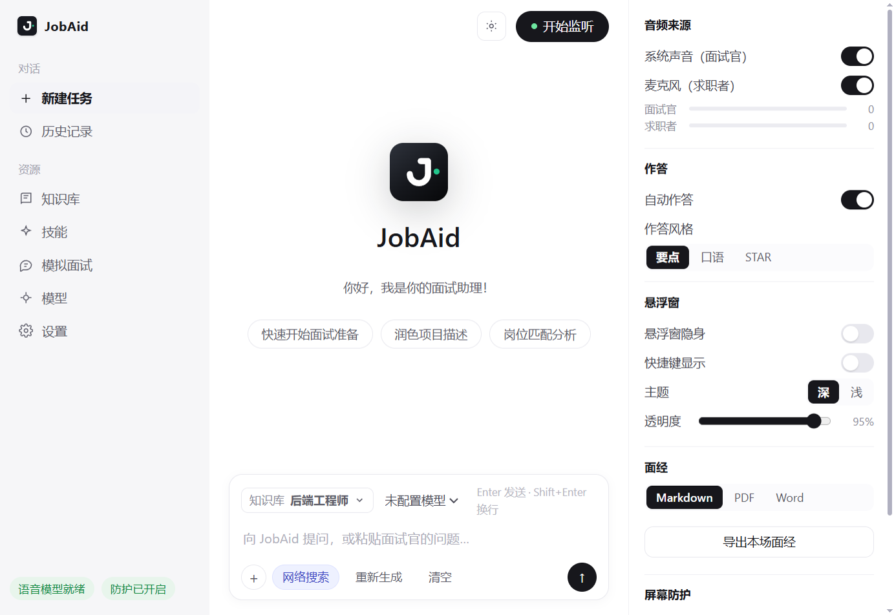
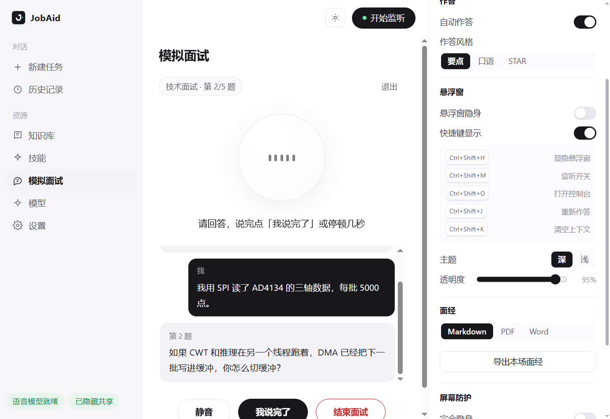

# JobAid

> 线上面试助手 —— 一个在 Windows 本地的桌面工具，围绕「练习—复盘—辅助」三个环节：

- **模拟面试**：根据个人简历和岗位 JD 自动出题，支持输入文字与实时语音作答
- **面经复盘**：将每场的提问、AI 回答、实际回答整理成文档，导出 Markdown / PDF / Word
- **实时辅助**：真实面试时听写提问，给出结构化参考回答，浮窗显示，可一键隐藏

生成回答时会调用个人配置的大模型接口。



---

## 功能

### 模拟面试

按简历和 JD 出题，覆盖技术深挖、行为面试、岗位匹配。两种作答方式：

- **文字作答**：支持来回切题修改答案，最后统一提交评分
- **语音作答**：模拟实时语音交互的面试场景

技术面试和 HR 面试的出题侧重不同。答完给出画像：总分、四个维度（技术深度 / 表达清晰 / 结构完整 / 岗位匹配）、强项、薄弱项、改进建议。


### 语音面试



### 面经导出

面试过程拆解成三段：面试官提问、AI 作答、个人实际作答。并支持导出 Markdown、Word 或 PDF三种文件格式。

### 防窥

- 窗口不进任务栏、标题中性化、托盘图标可隐藏，按快捷键`Ctrl+Shift+O` 恢复。
- 共享屏幕时开启屏幕捕获防护
- 浮窗可隐身，配合快捷键随时显隐

---

## 下载

到 [Releases](https://github.com/Howard-Peng002/JobAid/releases) 下载最新的 `JobAid-Setup.exe`。

## 快速开始

安装后需：

**1. 配模型**

左侧栏「模型」→ 添加供应商，推荐 DeepSeek：

```
Base URL : https://api.deepseek.com
API Key  : 到 platform.deepseek.com 申请
模型      : deepseek-flash（快）｜deepseek-v4-pro（强，但每题要等 10-25 秒）
```

**2. 导入简历和 JD**

左侧栏「知识库」→ 上传简历文本，再填目标岗位的 JD。

配好后去「模拟面试」选题量开始练，或去「新建任务」开启直接面试实时辅助。

## 快捷键

| 快捷键 | 作用 |
|---|---|
| `Ctrl+Shift+O` | 打开控制台（隐藏后唯一的找回方式） |
| `Ctrl+Shift+H` | 显示 / 隐藏浮窗 |
| `Ctrl+Shift+M` | 开关监听 |
| `Ctrl+Shift+J` | 对当前问题重新作答 |
| `Ctrl+Shift+K` | 清空上下文 |

---

## 免责声明

本项目仅供**面试练习**使用。

请勿在要求独立作答的正式测评、笔试或考试中使用。使用本工具产生的后果由使用者自行承担，作者不对因使用本软件导致的任何纠纷或损失负责。

## License

MIT
