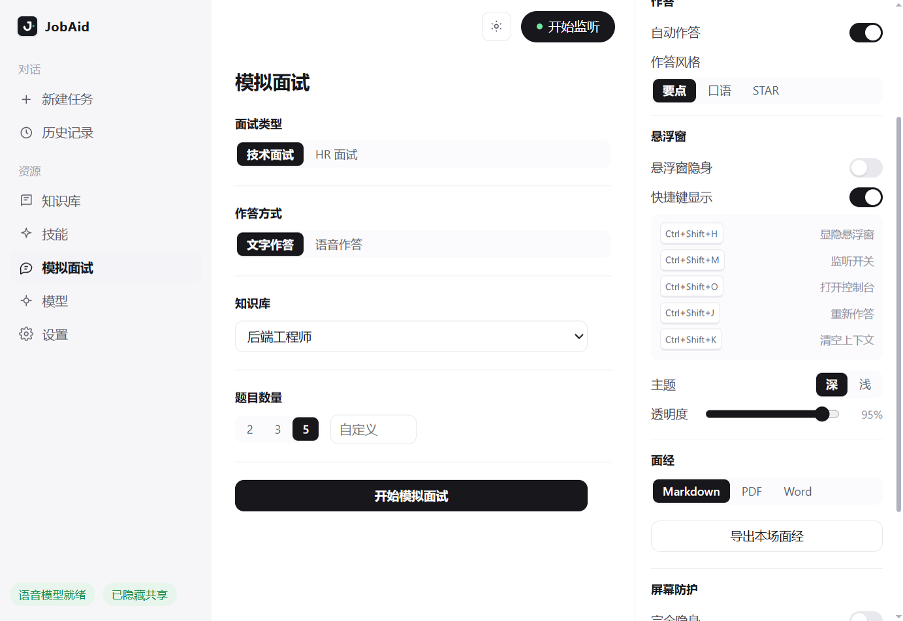

# JobAid · 面试练习与复盘助手

> 把简历和岗位变成一场可以反复练的面试，练完告诉你差在哪。

一个跑在 Windows 本地的桌面工具，围绕「练习—复盘—改进」三个环节：

- **模拟面试**：按你的简历和岗位 JD 自动出题，可以打字作答，也可以像打电话一样语音问答
- **面经复盘**：把每场的提问、AI 回答、你的实际回答整理成文档，导出 Markdown / PDF / Word
- **实时辅助**：真实面试时听写提问，给出结构化参考回答（浮窗显示，可一键隐藏）

简历、JD、语音转写全部只存本机。只有生成回答时会调用你自己配置的大模型接口。


---

## 功能

### 模拟面试

按简历和 JD 出题，覆盖技术深挖、行为面试、岗位匹配。两种作答方式：

- **文字作答**：可以来回切题修改答案，最后统一提交评分
- **语音作答**：面试官念题 → 你开口答 → 停顿自动进下一题，也可以点「我说完了」主动收尾

技术面试和 HR 面试的出题侧重完全不同。答完给一份画像：总分、四个维度（技术深度 / 表达清晰 / 结构完整 / 岗位匹配）、强项、薄弱项、改进建议。



### 语音面试

念题用微软 Edge 神经语音（免费、无需 Key），7 个中文音色可选；作答走本地语音识别模型，音频不出本机。

会追问——抓你上一句里的模糊点继续问，也会直说「你刚才讲到别的项目去了」。


### 面经导出

一场面试整理成三段：面试官问了什么、AI 建议怎么答、你实际说了什么。导出 Markdown、Word 或 PDF。

### 防窥

- 窗口不进任务栏、标题中性化、托盘图标可隐藏（`Ctrl+Shift+O` 找回）
- 屏幕捕获防护（`WDA_EXCLUDEFROMCAPTURE`，能挡系统截图和多数录屏）
- 浮窗可隐身，配合快捷键随时显隐

---

## 下载

到 [Releases](https://github.com/Howard-Peng002/JobAid/releases) 下载最新的 `JobAid-Setup.exe`。

Windows 可能提示「已保护你的电脑」——这是没买代码签名证书导致的，不是病毒。点「更多信息」→「仍要运行」。

## 快速开始

装完必须做两件事，否则不能用：

**1. 配模型**

左侧栏「模型」→ 添加供应商，推荐 DeepSeek：

```
Base URL : https://api.deepseek.com
API Key  : 到 platform.deepseek.com 申请
模型      : deepseek-chat（快）｜deepseek-v4-pro（强，但每题要等 10-25 秒）
```

**2. 导入简历和 JD**

左侧栏「知识库」→ 粘贴简历文本，再填目标岗位的 JD。这两样直接决定出题和答案质量。

配好后去「模拟面试」选题量开始练，或去「新建任务」开实时辅助。

## 快捷键

| 快捷键 | 作用 |
|---|---|
| `Ctrl+Shift+O` | 打开控制台（隐藏后唯一的找回方式） |
| `Ctrl+Shift+H` | 显示 / 隐藏浮窗 |
| `Ctrl+Shift+M` | 开关监听 |
| `Ctrl+Shift+J` | 对当前问题重新作答 |
| `Ctrl+Shift+K` | 清空上下文 |

---

## 技术栈

- **Electron 33** + 原生 HTML/CSS/JS，没有前端框架
- **本地语音识别**：ONNX Runtime + SenseVoice，纯本地推理
- **语音合成**：Edge TTS（`msedge-tts`），7 个中文神经音色
- **大模型**：OpenAI 兼容接口，供应商可自由配置
- **存储**：本地 JSON，路径 `%APPDATA%\interview-copilot`

自带一套诊断模式，改完直接验证：

```bash
npm start -- --uitest        # 界面回归
npm start -- --mocktest      # 模拟面试全流程
npm start -- --voicetest     # 语音识别链路
npm start -- --traytest      # 托盘与后台隐藏
npm start -- --settingstest  # 设置页
```

## 本地开发

```bash
npm install
npm start        # 开发模式
npm run build    # 打 Windows 安装包
```

首次启动会自动下载语音识别模型（约 229MB）到 `models/`。

详细的界面结构与实现说明见 [docs/DEVELOPMENT.md](docs/DEVELOPMENT.md)。

---

## 隐私

| 数据 | 去向 |
|---|---|
| 简历、JD | 只存本机 |
| 面试语音、转写文本 | 只存本机，识别在本地跑 |
| 模型 API Key | 只存本机 |
| 发给大模型的内容 | 仅当前问题与相关简历片段 |

删掉 `%APPDATA%\interview-copilot` 等于清空全部数据。

## 免责声明

本项目仅供**个人技术学习与面试练习**使用。

请勿在要求独立作答的正式测评、笔试或考试中使用。使用本工具产生的后果由使用者自行承担，作者不对因使用本软件导致的任何纠纷或损失负责。

如果用它准备面试，建议重心放在「模拟 → 复盘 → 改进」这个循环，而不是临场依赖。

## License

MIT
